<div align="center">

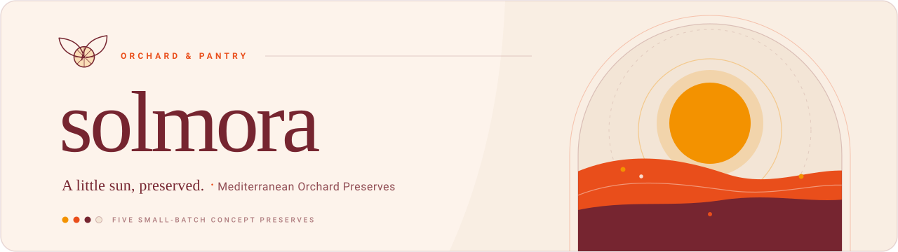

# SOLMORA · Mediterranean Orchard Preserves

**A little sun, preserved.** — An editorial concept showcase for small-batch Mediterranean marmalades and orchard preserves, crafted with buildless HTML5, CSS3, and vanilla JavaScript.

[](#technical-architecture--project-structure)
[](#visual-system-typography--motion)
[](#technical-architecture--project-structure)
[](#what-is-solmora)
[](https://github.com/annoris/solmora/actions/workflows/check.yml)
[](LICENSE)

[**Live Showcase (GitHub Pages)**](https://annoris.github.io/solmora/) · [Visual Walkthrough](#visual-page-walkthrough) · [Product Gallery](#product--original-imagery-gallery) · [Design System](#visual-system-typography--motion) · [Local Setup](#running-locally-validation--screenshot-capture)

<br />


</div>

---

## Table of Contents

- [What is SOLMORA?](#what-is-solmora)
- [Visual Page Walkthrough](#visual-page-walkthrough)
- [Product & Original Imagery Gallery](#product--original-imagery-gallery)
- [Visual System, Typography & Motion](#visual-system-typography--motion)
- [Technical Architecture & Project Structure](#technical-architecture--project-structure)
- [Running Locally, Validation & Screenshot Capture](#running-locally-validation--screenshot-capture)
- [GitHub Pages Deployment](#github-pages-deployment)
- [References & License](#references--license)

---

## What is SOLMORA?

**SOLMORA** is an English-language editorial concept website celebrating a fictional Mediterranean pantry of small-batch orchard preserves and marmalades (*"A little sun, preserved."*). Designed around sunlit terracotta tones, high-contrast display serif typography, tactile glass-jar studio cutouts, and serene pacing, the site invites visitors to explore five distinct preserves, read orchard stories, discover everyday food pairings, and open full-screen product journals without leaving the single-page flow.

> **Concept Project Notice:** SOLMORA is an independent design and front-end engineering showcase. No products are sold, no orders or personal data are collected, and all interactions run strictly client-side in the browser without tracking cookies or analytics.

### Key Highlights

- **Zero-Dependency, Buildless Stack:** Pure semantic `HTML5`, layered `CSS3`, and modular vanilla `JavaScript`—no frameworks, no CSS preprocessors, no runtime packages, and zero build tooling required.
- **Inclined Interactive Jar Orbit (`.jar-orbit`):** A 10-slot continuous carousel (`5` preserves doubled for seamless wrap-around) tilted on a `-10deg` axis with custom spring-damper physics (`requestAnimationFrame`), pointer dragging, horizontal trackpad wheel support, pointer depth parallax, `prev` / `next` controls, and arrow-key navigation.
- **Fullscreen Product Story Dialog (`#product-dialog`):** Native `<dialog>` modal styled as a full-bleed editorial product page with giant background display type, scroll-linked jar parallax (`--detail-shift`), tasting notes, pairing rituals, concept recipes, related jar switcher, `Escape` closing, and shareable URL hash deep-linking (`#product=<slug>`).
- **Editorial Scroll Choreography (`motion.js`):** Per-character clipped-mask headline entrances (`.ink-reveal`), intersection-triggered section reveals (`[data-reveal]`), smooth vertical scroll parallax (`[data-parallax]`) on orchard photography, and an endless CSS marquee banner (`.slow-banner`).
- **Accessible & Resilient by Design:** Skip link, semantic landmarks, `inert` background locking when the fullscreen drawer opens, `44px` minimum touch targets (`accessibility.css`), high-contrast `:focus-visible` rings, static CSS fallback when JavaScript is unavailable, and complete `@media (prefers-reduced-motion: reduce)` support.

### Why Buildless? (SOLMORA vs. Heavy Frontend Stacks)

| Capability | SOLMORA (Buildless HTML5 / CSS3 / Vanilla JS) | Typical Framework + Bundler Template |
| :--- | :---: | :---: |
| **Runtime Dependencies** | **0 packages** (`node_modules` not required) | 500–1,500+ packages |
| **Build Step / Cold Start** | **Instant** (serves `index.html` directly) | Vite / Webpack / Next.js compile step |
| **Physics-Driven Carousel** | Custom `requestAnimationFrame` spring-damper | External carousel library + polyfills |
| **Fullscreen Product Modals** | Native HTML `<dialog>` + URL hash routing | Custom portal + focus-trap dependency |
| **Accessibility & Reduced Motion** | Built-in `inert`, `44px` targets, no-JS fallback | Often requires extra plugins |
| **Static Hosting** | Push to `main` → live on GitHub Pages | CI build pipeline + artifact upload |

---

## Visual Page Walkthrough

Every screenshot below was captured directly from the live rendered site using headless Chromium (`1440×900` desktop and `390×844` `@2x` mobile) via `npm run screenshots`.

### 1. Hero Stage & Inclined Jar Orbit (`#home`)

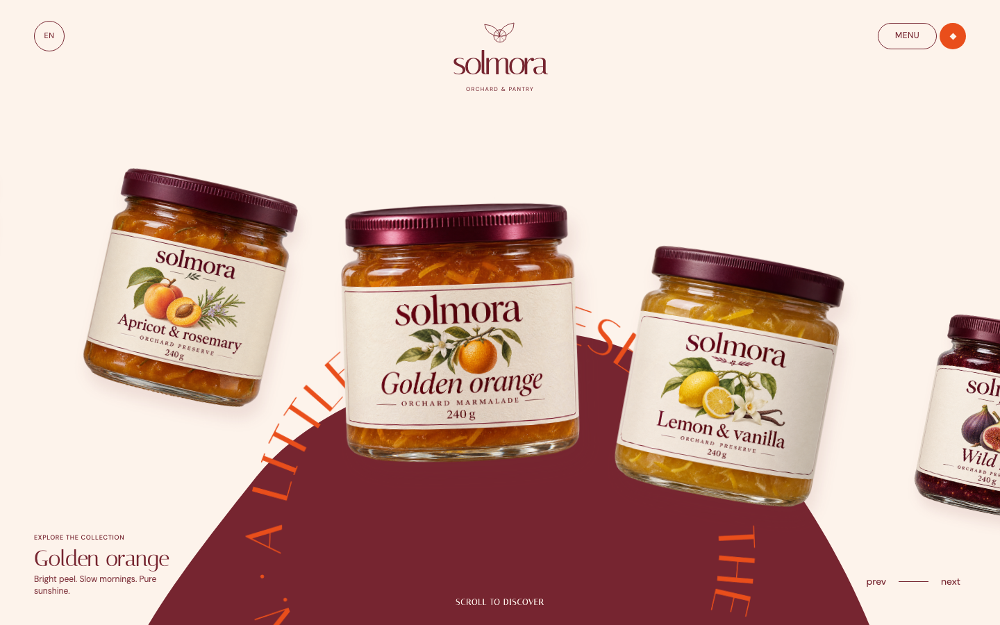

- **On Screen:** A full-viewport (`100svh`) cream stage (`#fdf3eb`) anchors the centered `solmora · ORCHARD & PANTRY` botanical citrus emblem and top bar (`MENU` + burnt-orange diamond badge). Across the middle sweeps an inclined ribbon of glass jars cast in warm studio lighting against an organic deep-burgundy silhouette (`.hero-shape`) and a rotating curved SVG seal (`A LITTLE SUN, PRESERVED. · THE ORCHARD COLLECTION.`).
- **Framing & Hierarchy:** Bottom-left `.hero-product` displays the currently centered jar's title (`Golden orange`) and subtitle (`Bright peel. Slow mornings. Pure sunshine.`); bottom-right `.orbit-controls` (`prev — next`) cycles through the collection; bottom-center `SCROLL TO DISCOVER` anchors the burgundy dome.
- **Interactions:** Drag horizontally across `.jar-orbit`, scroll sideways with a trackpad, press `ArrowLeft` / `ArrowRight`, click `prev` / `next`, or click the centered jar (`aria-current="true"`) to launch its fullscreen product story.

---

### 2. The Pantry Collection (`#pantry`)

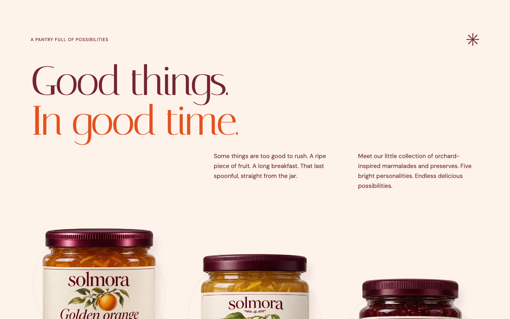

- **On Screen:** A crisp editorial header (`A PANTRY FULL OF POSSIBILITIES`) paired with a botanical asterisk mark (`✳`) introduces the staggered two-tone serif display headline *"Good things. In good time."* (`#762530` burgundy and `#e94e1b` orange) and a two-column narrative introduction.
- **Grid Composition:** Below the intro, `.pantry-grid` arranges all five preserves in an asymmetrical three-column editorial stagger (`margin-top` offsets of `0`, `80px`, and `160px`) where each jar rests over subtle concentric orbital hairlines (`.card-orbit`) and lists its category (`MARMALADE` or `PRESERVE`), flavor title, and short tagline.
- **Interactions:** Hovering a `.product-card` tilts and lifts its studio jar cutout (`rotate(-12deg) scale(1.08)`); clicking any card opens `#product-dialog` directly to that preserve and updates the URL hash to `#product=<slug>`.

---

### 3. Our Orchard Editorial & Marquee (`#orchard`)

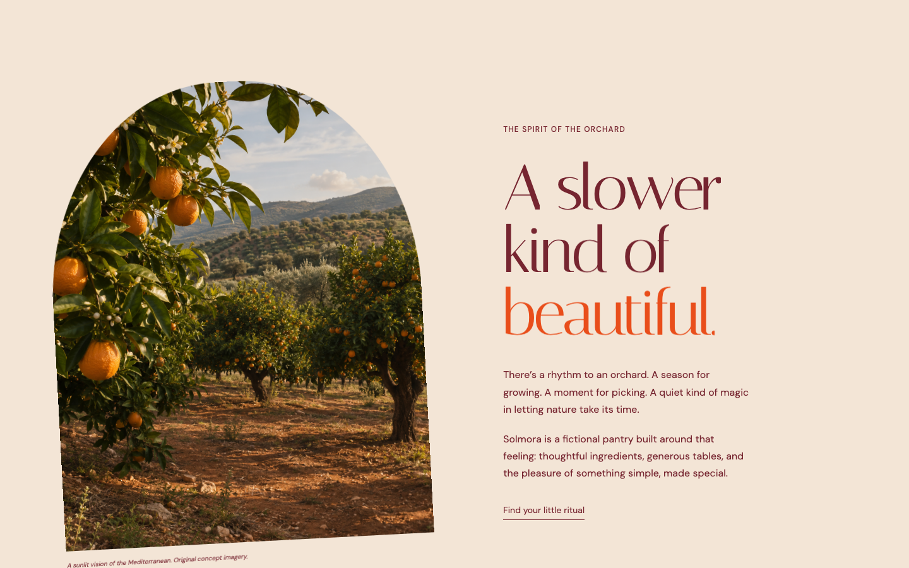

- **On Screen:** Set over warm sand (`#f3e5d6`), `.orchard` pairs an arched portrait photograph (`assets/images/orchard-editorial.png`, `border-radius: 47% 47% 0 0`) tilted at `-3deg` on the left with the editorial narrative *"A slower kind of beautiful."* on the right, finished with an underlined jump link (`Find your little ritual` → `#rituals`).
- **Motion & Depth:** The arched frame carries `data-parallax="0.08"`, applying subtle scroll-linked vertical travel (`--parallax-y`, clamped within `±48px`) as the reader moves through the orchard story.
- **Transition Band:** Directly beneath `#orchard`, `.slow-banner` renders a full-bleed burnt-orange (`#e94e1b`) marquee continuously drifting *"A little sun, preserved. ✳"* across the viewport (paused smoothly under `prefers-reduced-motion: reduce`).

---

### 4. Little Rituals (`#rituals`)

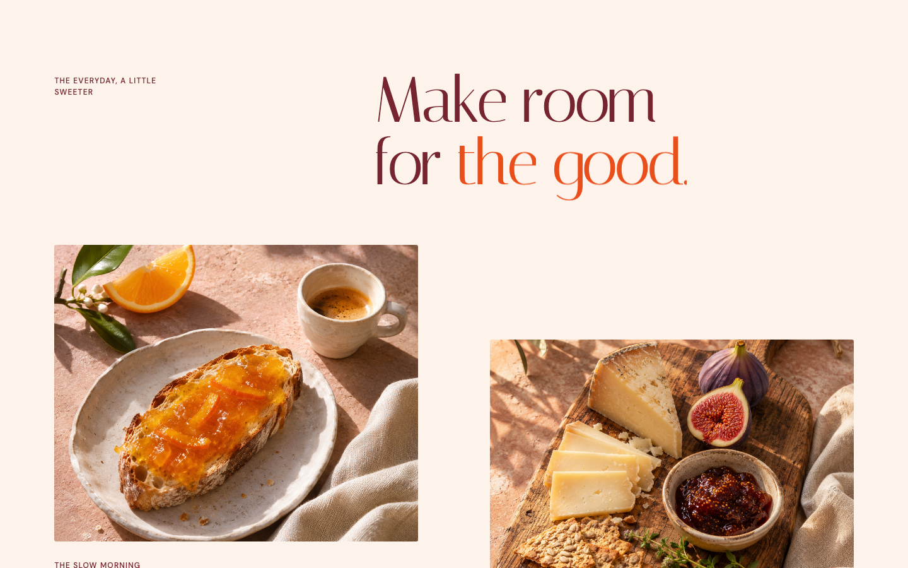

- **On Screen:** Opening with the asymmetric header `THE EVERYDAY, A LITTLE SWEETER` beside *"Make room for the good."*, `.ritual-grid` showcases two borderless editorial still-life stories offset vertically (`margin-top: 150px` on the second column):
  - **The Slow Morning:** Golden orange marmalade spread generously over warm sourdough toast beside espresso (`assets/images/breakfast-editorial.png`) — *"Toast. Coffee. Absolutely no hurry."*
  - **The Long Table:** Aged cheeses, fresh figs, crackers, walnuts, and fig preserve on oak (`assets/images/cheeseboard-editorial.png`) — *"A little more. For everyone."*
- **Motion:** Both `<article>` blocks enter via `[data-reveal]` (`opacity` and `28px` vertical glide) coordinated by `IntersectionObserver`.

---

### 5. Contact & Footer (`#contact`)

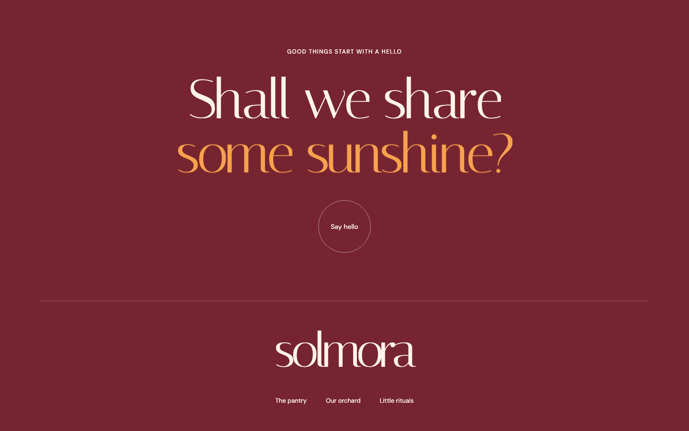

- **On Screen:** A rich full-bleed burgundy (`#762530`) finale transitions from warm cream/sand into high-contrast ivory (`#fdf3eb`) and warm apricot-gold (`#f8a14e`) typography: *"GOOD THINGS START WITH A HELLO — Shall we share some sunshine?"*.
- **Interactive Disclosure:** Clicking the circular `Say hello` button (`#contact-button`, rotating `-10deg` into burnt orange on hover) toggles the glassmorphic `#contact-message` concept note (`aria-expanded` + `role="status"`).
- **Footer:** Framed beneath a delicate hairline rule sit the oversized `solmora` serif wordmark, quick section links (`The pantry`, `Our orchard`, `Little rituals`), dynamic copyright year, and the `Privacy & cookies` trigger (`#privacy-button`) opening `#privacy-dialog`.

---

### 6. Fullscreen Product Detail Story (`#product-dialog`)

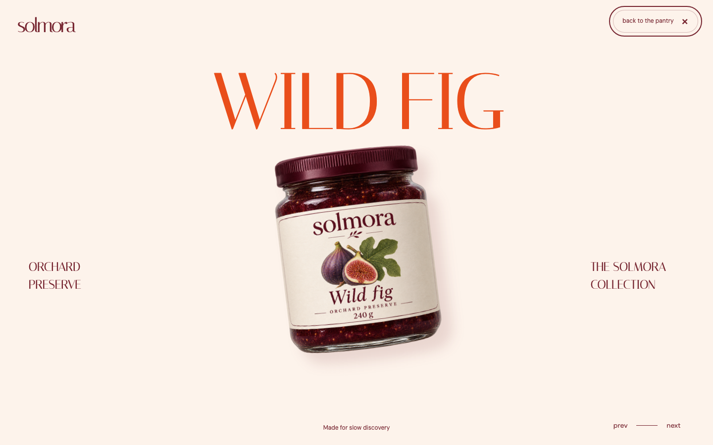

- **On Screen:** Clicking any jar in the hero orbit or pantry grid—or visiting `#product=wild-fig` directly—opens `<dialog id="product-dialog">` as a full-screen editorial product route. Behind the floating tilted studio jar sits oversized uppercase `Italiana` display typography (`WILD FIG` in `#e94e1b`), flanked by category (`ORCHARD PRESERVE`) and collection (`THE SOLMORA COLLECTION`) metadata, `Made for slow discovery`, `prev — next`, and the floating `back to the pantry ×` pill.
- **Scrollable Story Below the Fold:** Scrolling inside the modal drives `--detail-shift` parallax between the giant title and jar while revealing:
  1. **Sensory Story & Flavor Notes** (`.detail-story`)
  2. **Three-Column Information Ledger** (`.detail-information`: *A Little Ritual*, *The Concept Recipe*, *A Little Perspective*)
  3. **Related Orchard Switcher** (`.detail-related`: five-column interactive jar row highlighting the active flavor with `.is-active`)
- **Keyboard & Routing:** Supports `Escape` to close, `ArrowLeft` / `ArrowRight` to step between flavors, `history.replaceState` synchronization with `#product=<slug>`, and focus restoration to the triggering control upon close.

---

### 7. Fullscreen Burgundy Navigation Menu (`#site-menu`)

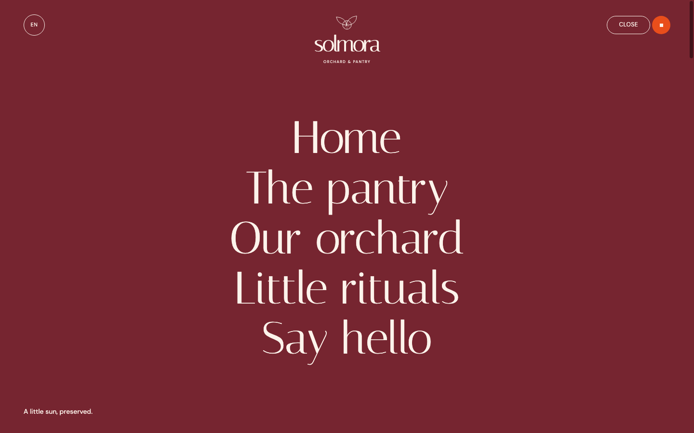

- **On Screen:** Activating `#menu-toggle` switches the header button to `CLOSE` with a burnt-orange square indicator and reveals the full-screen `#762530` navigation overlay over inverted cream typography (`Home`, `The pantry`, `Our orchard`, `Little rituals`, `Say hello`) and the bottom tagline *"A little sun, preserved."*
- **Focus & Accessibility:** Opening the drawer sets `main.inert = true`, locks body scroll (`.menu-open`), traps `Tab` / `Shift+Tab` cycling across header controls and menu links, closes on `Escape`, and smoothly jumps to the chosen section while returning focus cleanly.

---

### 8. Responsive Mobile Layout (`390×844 @2x`)

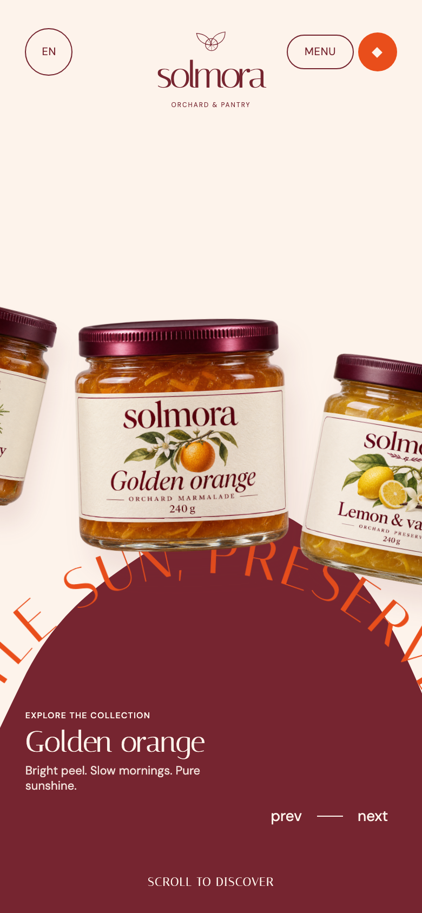

- **On Screen:** Below `650px` (`art-direction.css` & `styles.css`), the header scales compactly (`120px` height), the organic burgundy dome widens (`width: 136%; left: -18%`) to frame `.hero-product` and `.orbit-controls` in high-contrast `#fdf3eb` cream text inside the dome, and `.jar-orbit` adjusts its spacing (`width / 1.9`) so the active jar sits squarely centered with zero horizontal overflow (`overflow-x: clip`).
- **Grid Adaptation:** Deeper in the mobile page, `.pantry-grid` collapses cleanly into a two-column staggered pantry layout, `.orchard` and `.ritual-grid` stack into single-column editorial stories, and `.detail-related-grid` wraps neatly into a two-column grid.

---

## Product & Original Imagery Gallery

All visual assets stored in [`assets/images/`](assets/images/) are original concept renders created specifically for SOLMORA—never copied from external sites.

### Five Small-Batch Preserves (Transparent Studio Cutouts)

<table>
  <thead>
    <tr>
      <th align="center" width="150">Jar Cutout</th>
      <th align="left" width="170">Preserve &amp; Category</th>
      <th align="left">Tasting Notes &amp; Concept Story</th>
      <th align="left">Suggested Ritual</th>
    </tr>
  </thead>
  <tbody>
    <tr>
      <td align="center">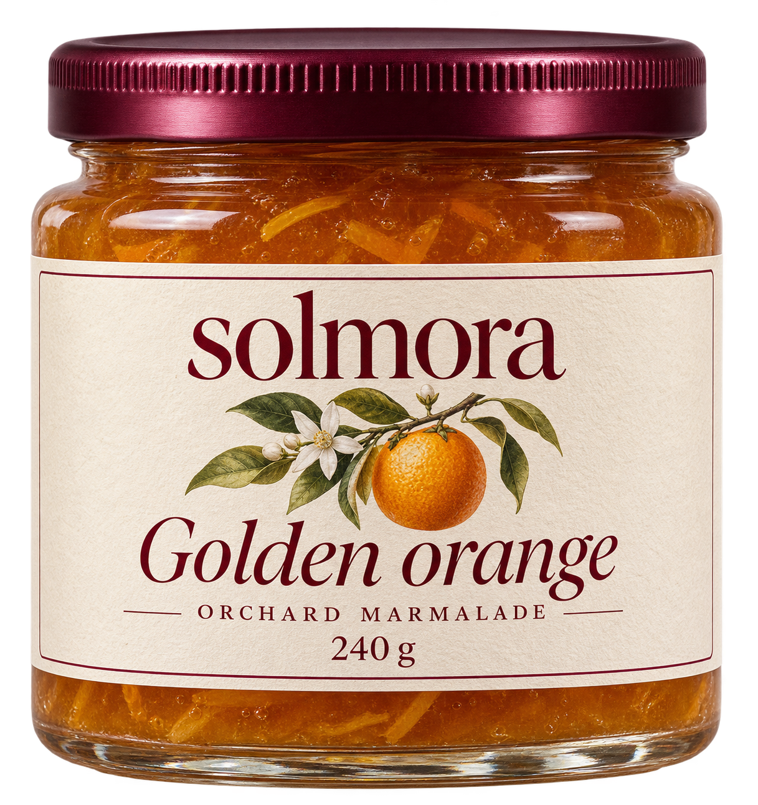</td>
      <td><strong>Golden orange</strong><br /><code>MARMALADE</code> · 240 g<br /><code>#product=golden-orange</code></td>
      <td><em>Bright citrus · Fine peel · A bittersweet finish</em><br />Bright citrus edge with soft shreds of peel and a balanced bittersweet finish.</td>
      <td>Spread generously over warm sourdough, swirl into yogurt, or share with a buttery pastry.</td>
    </tr>
    <tr>
      <td align="center">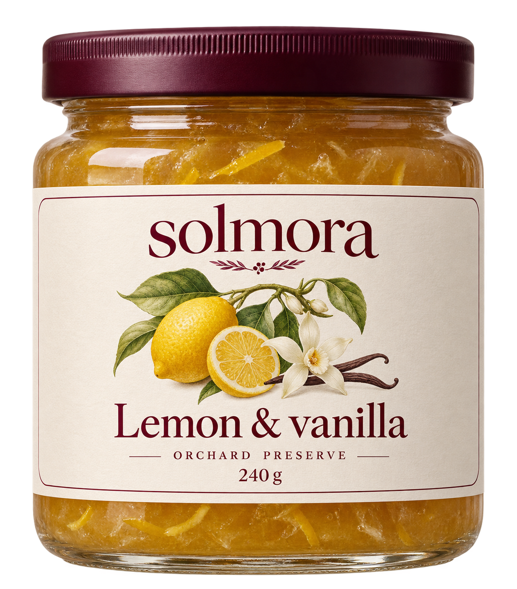</td>
      <td><strong>Lemon &amp; vanilla</strong><br /><code>PRESERVE</code> · 240 g<br /><code>#product=lemon-vanilla</code></td>
      <td><em>Fresh lemon · Soft vanilla · A gentle citrus lift</em><br />Sharp meets soft: vibrant orchard lemon balanced by mellow vanilla.</td>
      <td>Spoon over ricotta, tuck into a sponge cake, or brighten morning toast.</td>
    </tr>
    <tr>
      <td align="center">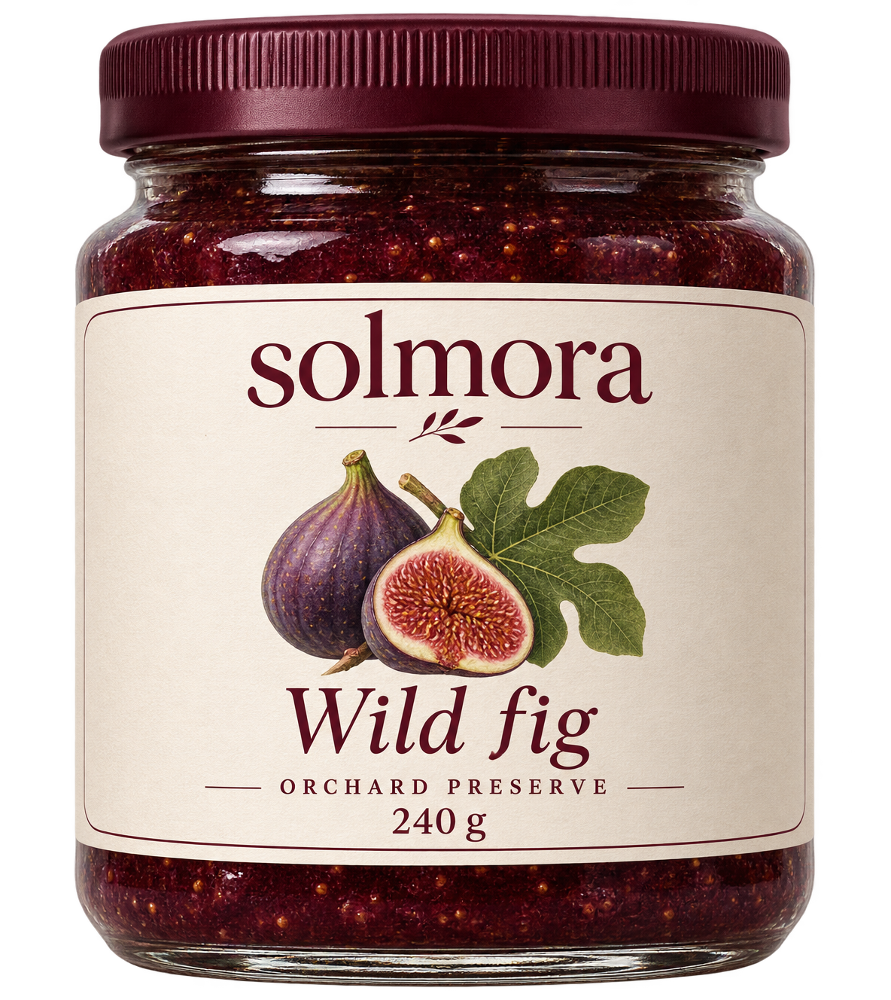</td>
      <td><strong>Wild fig</strong><br /><code>PRESERVE</code> · 240 g<br /><code>#product=wild-fig</code></td>
      <td><em>Late-summer fruit · Soft seeds · Mellow sweetness</em><br />Rich, deeply mellow fig capturing the spirit of an unhurried Mediterranean table.</td>
      <td>Serve alongside aged cheese, toasted walnuts, and crisp grain crackers.</td>
    </tr>
    <tr>
      <td align="center">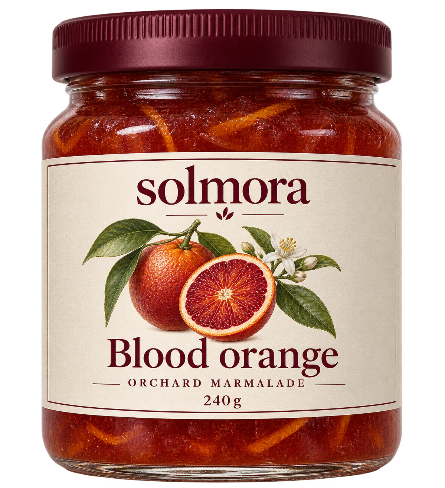</td>
      <td><strong>Blood orange</strong><br /><code>MARMALADE</code> · 240 g<br /><code>#product=blood-orange</code></td>
      <td><em>Deep citrus · Ruby fruit · A lively bitter edge</em><br />Bold, ruby-toned citrus marmalade with a lively bittersweet twist.</td>
      <td>Layer into a dark chocolate tart, serve with a fresh scone, or pair with toast.</td>
    </tr>
    <tr>
      <td align="center">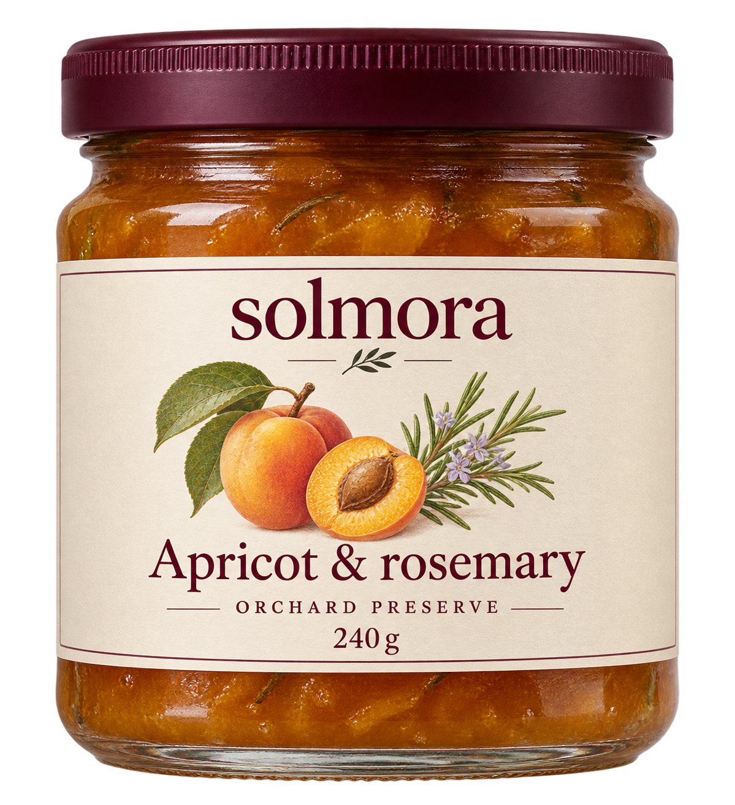</td>
      <td><strong>Apricot &amp; rosemary</strong><br /><code>PRESERVE</code> · 240 g<br /><code>#product=apricot-rosemary</code></td>
      <td><em>Golden fruit · Fragrant herbs · A sun-warmed finish</em><br />Soft sun-ripened apricot paired with an aromatic hint of rosemary.</td>
      <td>Spoon onto a warm croissant, pair with creamy cheese, or top a summer dessert.</td>
    </tr>
  </tbody>
</table>

### Three Original Editorial Photographs

<table>
  <thead>
    <tr>
      <th align="center" width="33%">Our Orchard (<code>#orchard</code>)</th>
      <th align="center" width="33%">The Slow Morning (<code>#rituals</code>)</th>
      <th align="center" width="33%">The Long Table (<code>#rituals</code>)</th>
    </tr>
  </thead>
  <tbody>
    <tr>
      <td align="center" valign="top">
        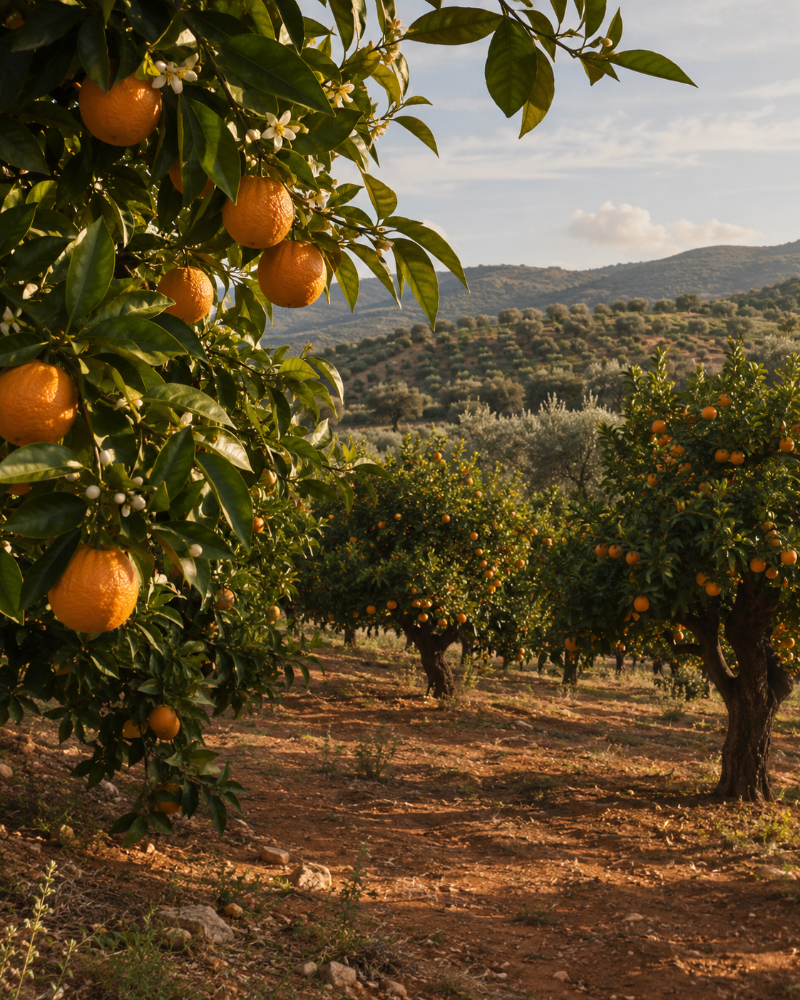<br /><br />
        <code>assets/images/orchard-editorial.png</code><br />
        <sub>Arched (<code>47% 47% 0 0</code>), tilted <code>-3deg</code> portrait with scroll parallax in the sand-toned orchard story section.</sub>
      </td>
      <td align="center" valign="top">
        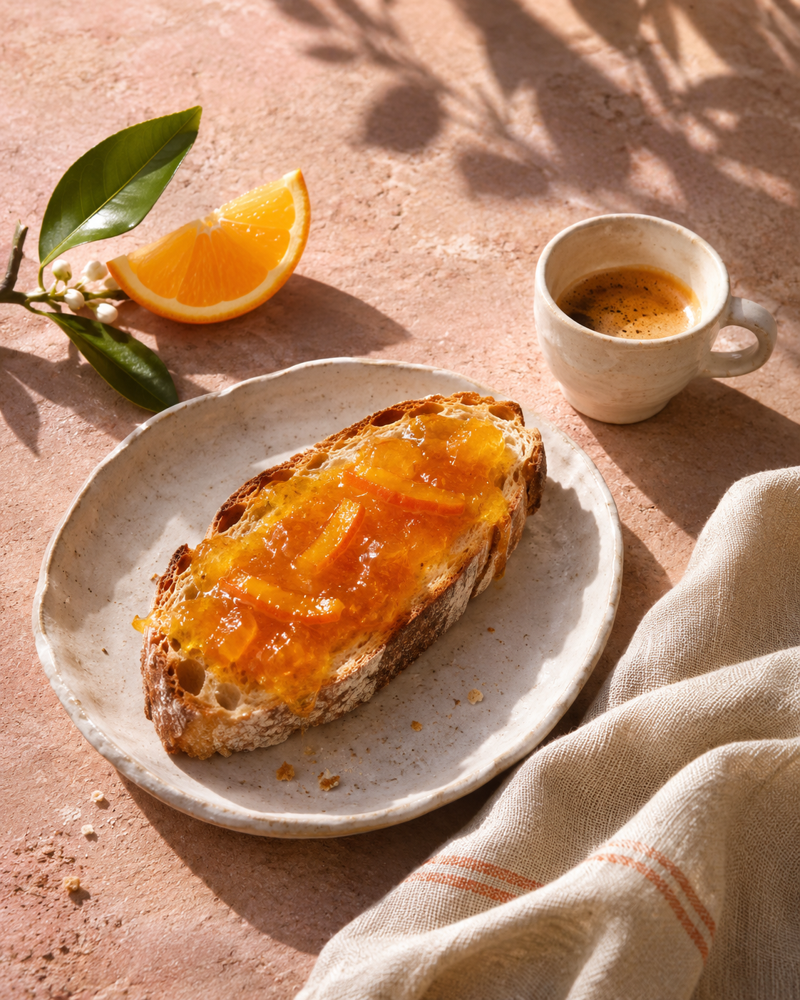<br /><br />
        <code>assets/images/breakfast-editorial.png</code><br />
        <sub>Left column ritual card pairing sourdough toast, orange marmalade, and espresso in sunlit limestone framing.</sub>
      </td>
      <td align="center" valign="top">
        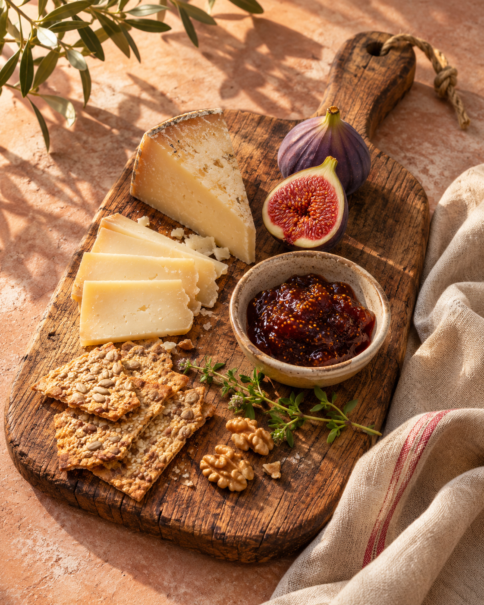<br /><br />
        <code>assets/images/cheeseboard-editorial.png</code><br />
        <sub>Staggered right column ritual card showcasing wild fig preserve on a rustic oak cheeseboard.</sub>
      </td>
    </tr>
  </tbody>
</table>

---

## Visual System, Typography & Motion

### Color Palette

| Token | Hex | Swatch Role | Usage Across the Site |
| :--- | :--- | :--- | :--- |
| `--cream` | `#fdf3eb` | Primary sun-washed canvas | Page background, dialog surface, light typography on burgundy |
| `--sand` | `#f3e5d6` | Warm limestone surface | `#orchard` background, `.detail-related` footer band, banner alcove |
| `--orange` | `#e94e1b` | Vivid terracotta-orange | Display italic highlights, `.orbit-seal`, `.slow-banner`, menu square badge, modal titles |
| `--wine` | `#762530` | Deep Mediterranean burgundy | Primary ink, `.hero-shape` dome, `#site-menu` drawer, `#contact` & footer background |
| `--yellow` | `#f39200` | Golden orchard sun | Sun accent inside brand banner and golden citrus highlights |
| *(Accent)* | `#f8a14e` / `#f5a34a` | Warm apricot highlight | Italic emphasis and concept note label over `--wine` surfaces |

### Typography

- **Display Serif — [`Italiana`](https://fonts.google.com/specimen/Italiana)** (`Bodoni MT`, `Didot`, `serif` fallback): High-contrast editorial display faces for the `solmora` wordmark, section headlines (`.display-title`), menu items, hero jar titles, and fullscreen product headers.
- **Supporting Sans — [`DM Sans`](https://fonts.google.com/specimen/DM+Sans)** (`system-ui`, `-apple-system`, `sans-serif` fallback): Clean geometric readability (`400`, `500`, `600`) for uppercase tracked micro-labels (`.tiny-label`), narrative paragraphs, controls, and dialogs.

### Motion & Physics Architecture

- **Spring-Damper Hero Orbit (`assets/js/motion.js`):** Tracks `position`, `target`, and `speed` inside `requestAnimationFrame` with gentle ambient drift (`0.105` steps/s), smooth pointer dragging (`setPointerCapture`), horizontal wheel momentum, and exponential focus scaling (`Math.exp(-distance * distance * 0.4)`) along a tilted `0.16` slope.
- **Clipped-Character Ink Reveals (`.ink-reveal`):** Splits `[data-reveal]` headings into per-character `.ink-mask` / `.ink-char` wrappers staggered by `20ms` (`--ink-delay`), revealed once via `IntersectionObserver` (`threshold: 0.12`).
- **Scroll-Linked Parallax (`[data-parallax]` & `--detail-shift`):** Moves `.orchard-art` vertically relative to viewport center (`±48px`) and shifts the jar vs. oversized title inside `#product-dialog` (`Math.min(90, scrollTop * 0.16)`).
- **Reduced Motion Compliance (`@media (prefers-reduced-motion: reduce)`):** Collapses animations/transitions to `0.01ms`, disables parallax offsets, keeps `.slow-track` static, locks `.ink-char` to visible, and snaps orbit stepping directly to `target`.

---

## Technical Architecture & Project Structure

```text
solmora/
├── index.html                        # Semantic single-page HTML structure, sections, and native <dialog> modals
├── package.json                      # Zero-dependency Node >=18 scripts (start, check, screenshots)
├── LICENSE                           # MIT License
├── README.md                         # Project documentation and visual guide
├── .github/
│   ├── assets/
│   │   └── banner.svg                # Original SVG repository hero banner
│   └── workflows/
│       └── check.yml                 # GitHub Actions CI running `npm run check` on Node 22
├── assets/
│   ├── css/
│   │   ├── styles.css                # Design tokens, base typography, header, menu, sections, responsive breakpoints
│   │   ├── art-direction.css         # Hero orbit composition, cutouts, arched photography, fullscreen product dialog
│   │   ├── motion.css                # Orbit transforms, ink-reveal masks, marquee animation, reduced-motion overrides
│   │   └── accessibility.css         # 44px touch targets, high-contrast focus rings, modal scroll lock, narrow viewports
│   ├── js/
│   │   ├── app.js                    # Product catalog data, modal/hash deep-linking (#product=<slug>), menu & focus logic
│   │   └── motion.js                 # Draggable inclined orbit physics, pointer parallax, [data-parallax], .ink-reveal
│   └── images/
│       ├── jar-orange.png            # Studio cutout: Golden orange marmalade (1217×1292)
│       ├── jar-lemon.png             # Studio cutout: Lemon & vanilla preserve (1176×1338)
│       ├── jar-fig.png               # Studio cutout: Wild fig preserve (1184×1328)
│       ├── jar-blood-orange.png      # Studio cutout: Blood orange marmalade (1199×1312)
│       ├── jar-apricot.png           # Studio cutout: Apricot & rosemary preserve (1199×1312)
│       ├── orchard-editorial.png     # Editorial photo: Mediterranean orange grove (1122×1402)
│       ├── breakfast-editorial.png   # Editorial photo: Sourdough toast & espresso (1122×1402)
│       ├── cheeseboard-editorial.png # Editorial photo: Fig preserve & aged cheeseboard (1122×1402)
│       ├── favicon.svg               # Citrus botanical icon
│       ├── grain.svg                 # Subtle grain texture vector
│       └── *.svg                     # Botanical vector accents (orange, lemon, fig, blood-orange, apricot)
├── docs/
│   ├── asset-prompts.md              # Original image-generation art-direction prompts
│   ├── reference-analysis.md         # Visual & motion architecture notes
│   └── screenshots/
│       ├── README.md                 # Catalog of captured screenshots and regeneration guide
│       └── 01-hero-orbit.png … 08-mobile-responsive.png
└── scripts/
    ├── serve.mjs                     # Lightweight local Node HTTP static server (default port 4175)
    ├── validate.mjs                  # Static integrity validator (IDs, anchors, CSS/HTML/README refs, JS syntax, 8 PNGs)
    └── capture-screenshots.mjs       # Headless Chrome CDP script capturing all 8 screenshots + smoke checks
```

---

## Running Locally, Validation & Screenshot Capture

Requires **Node.js 18+** (no `npm install` needed—zero external dependencies).

```bash
# 1. Start the local static preview server (http://127.0.0.1:4175)
npm start

# 2. Run static validation checks (HTML IDs/anchors, CSS/README refs, JS syntax, 8 core PNGs)
npm run check

# 3. Regenerate all 8 live screenshots into docs/screenshots/ via headless Google Chrome CDP
#    (requires Google Chrome installed; override binary with CHROME_PATH if needed)
npm run screenshots
```

- `npm start` executes [`scripts/serve.mjs`](scripts/serve.mjs) on `127.0.0.1:4175` (configurable via `PORT`).
- `npm run check` executes [`scripts/validate.mjs`](scripts/validate.mjs), verifying unique HTML IDs, valid internal anchor links, valid local file paths across `index.html`, CSS `url(...)` rules, and `README.md` images, `node --check` syntax across all `.js`/`.mjs` files, and non-empty presence of all 8 core PNGs in `assets/images/`.
- `npm run screenshots` executes [`scripts/capture-screenshots.mjs`](scripts/capture-screenshots.mjs), spinning up an ephemeral static server, launching headless Chromium over Chrome DevTools Protocol, waiting for fonts and image decoding, asserting interactive smoke checks (`#product=wild-fig` deep-link + `Escape` close + zero runtime console/page errors), and saving all 8 PNGs to `docs/screenshots/`.

---

## GitHub Pages Deployment

SOLMORA is a pure static site served directly from the repository root (`/` on `main`)—no build step or artifact compilation required:

1. **Continuous Validation:** [`.github/workflows/check.yml`](.github/workflows/check.yml) runs `npm run check` on every push and pull request using Node 22.
2. **Pages Hosting:** GitHub Pages serves [`index.html`](index.html) directly from `main` at **`https://annoris.github.io/solmora/`** with relative asset paths (`assets/...`).

---

## References & License

- [Visual & Motion Reference Analysis](docs/reference-analysis.md)
- [Original Image Art-Direction Prompts](docs/asset-prompts.md)
- [Screenshot Suite Guide](docs/screenshots/README.md)
- Released under the [MIT License](LICENSE).

---

## More Projects by Annoris

- [**Aetheris**](https://github.com/annoris/aetheris) — Zero-dependency AI Agent & Automation Platform (77 specialized agents, 328 workflow skills, MCP & hooks dashboard for Claude Code, Cursor & Codex)
- [**TabVento**](https://github.com/annoris/tabvento) — Modern browser tab & workspace organizer built for focus and speed
- [**Aurelia**](https://github.com/annoris/aurelia) — Refined web experience and design showcase by Annoris
